I study how neural networks keep, merge and lose what they learn: **continual learning**, **model merging and symmetry**,
and **making fine-tuned LLMs honest about what they don't know**. I also build agents and robot policies.

 

- 📄 **Paper accepted at NeurIPS 2026 (workshop):** *Symmetry Alignment Across Depth in Transformer Merging*
- 🏆 **Winner, HackIIITD 2026** with **Riptide**, a test bench for AI shopping agents
- 🛡️ **HUMBLE**, Lexsi AI Safety & Alignment Hackathon (Track 1): catches and repairs fine-tuned RAG models that make up answers
- 🔬 Research interests: continual learning · linear mode connectivity · LLM reliability · VLAs · AI for science

 

## Selected work

🎮 Each card has its own creature, and each one has a move. <a href="https://mudgalkrishna.github.io/mudgalKrishna/mascots.html">Hover them on the playground</a> to see Mirror Beam, Aqua Jet, Ember Burst and Volt Shock.

### 📄 Symmetry Alignment Across Depth in Transformer Merging · *NeurIPS 2026 workshop*

 

Two Transformers trained from different seeds can be merged with almost no loss once you undo their parameter symmetries,
but only if they have the same depth. We asked what happens when one is deeper. We pad the shallow model with exact identity
blocks so both live in the same parameter space, then align them with permutations and orthogonal maps. On WikiText-2,
Penn Treebank and Tiny Shakespeare, alignment removes **90.1–94.6%** of the naive barrier, but a residual of
**0.098–0.244 nats** survives in every configuration. That residual depends on width and on where the identity blocks go,
not on how many there are.

 

<table>
<tr>
<td width="50%" valign="top">

### 🛡️ [HUMBLE](https://github.com/mudgalKrishna/HUMBLE)
 

Fine-tuning a RAG chatbot quietly teaches it to **invent answers** when its documents don't have one. Standard evals miss
this, because they only ask answerable questions. HUMBLE is a release gate: it probes unanswerable questions, returns
**PASS / BLOCK**, and repairs a blocked adapter in about **15 minutes**. It runs on one GPU with open Cohere models.

[Live demo](https://huggingface.co/spaces/KM2007/humble-explorer) · [Repaired model](https://huggingface.co/KM2007/humble-tinyaya-repaired-A) · [Write-up](https://github.com/mudgalKrishna/HUMBLE/blob/main/docs/WRITEUP.md)

</td>
<td width="50%" valign="top">

### 🌊 [Riptide](https://github.com/sortedcord/riptide) · *HackIIITD 2026 winner*
 

AI agents are starting to shop for us, and dark patterns fool them. Riptide has five honest Indian-style shops. A
"Trickster" LLM edits their real code to plant dark patterns from India's CCPA guidelines, and a scorer watches what a
shopping agent actually does in the browser. The result is a rating for each agent, with evidence, over the open
**A2A** protocol.

[Repo](https://github.com/sortedcord/riptide) · [Dark-pattern taxonomy](https://github.com/sortedcord/riptide/blob/master/docs/TAXONOMY.md)

</td>
</tr>
<tr>
<td width="50%" valign="top">

### 🤖 [Bi-Manual VLA](https://github.com/mudgalKrishna/Bi-Manual_VLA)
 

Two SO-101 arms learn to set a dinner table. Grasping is **purely physical**: no welds and no teleports, and if friction
fails the object drops and the episode is rejected. **71 episodes (218k frames)** feed a fine-tuned **SmolVLA**, which
runs on Intel Core Ultra (CPU/GPU/NPU via OpenVINO).

[Repo + video](https://github.com/mudgalKrishna/Bi-Manual_VLA) · [Weights](https://huggingface.co/TASMAYU/Bi-Manual-SmolVLA)

</td>
<td width="50%" valign="top">

### 🧪 More research
- [**ESM-2 structure adapter**](https://github.com/mudgalKrishna/Parameter-Efficient-ESM-2-Structure-Adapter-for-Protein-Stability-Prediction): parameter-efficient protein stability prediction
- [**PhysicsConstraints**](https://github.com/mudgalKrishna/PhysicsConstraints): physics-informed learning
- [**TITANS for HEP**](https://github.com/mudgalKrishna/TITANS-for-HEP) and [**SYMBA amplitudes**](https://github.com/mudgalKrishna/Foundation-Models-for-Squared-Amplitude-Calculation_Symba): foundation models for particle physics
- [**GEN_RESIST**](https://github.com/mudgalKrishna/GEN_RESIST): antimicrobial resistance predictor ([live](https://mudgalkrishna.github.io/GEN_RESIST/))

</td>
</tr>
</table>

 

**Stack:** Python · PyTorch · Hugging Face (Transformers, PEFT, TRL) · LeRobot · MuJoCo · TypeScript

